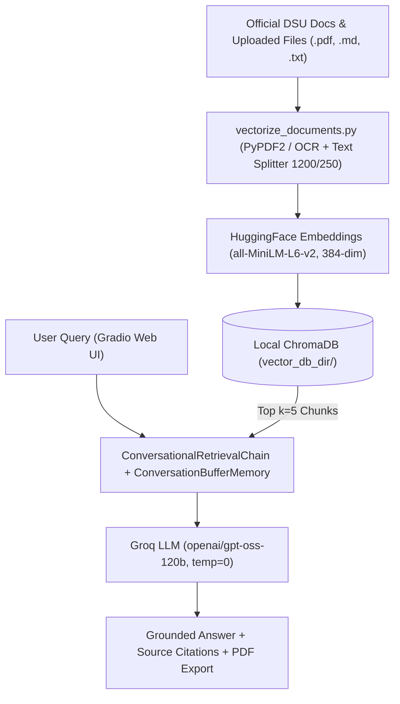

# Campus Care — Dayananda Sagar University (DSU) AI Student Support Assistant

**Author & Implementer:** Misbha ([`misbha-khanum`](https://github.com/misbha-khanum))  
**Personalized For:** Dayananda Sagar University (DSU), Bengaluru  
**Tech Stack:** Gradio · LangChain · ChromaDB · HuggingFace Embeddings · Groq (`openai/gpt-oss-120b`)

**Campus Care** is an end-to-end **Retrieval-Augmented Generation (RAG)** AI assistant built to answer questions from students, prospective applicants, and parents using Dayananda Sagar University's verified institutional documents. Instead of relying on generic LLM training data, it retrieves relevant passages from a local **ChromaDB** vector store and generates accurate, structured, source-cited answers.

---

## Table of Contents

- [Key Features](#key-features)
- [System Architecture](#system-architecture)
- [Technology Stack](#technology-stack)
- [Knowledge Base Coverage (`data/`)](#knowledge-base-coverage-data)
- [Project Structure](#project-structure)
- [Prerequisites](#prerequisites)
- [Installation & Setup (Windows PowerShell)](#installation--setup-windows-powershell)
- [Data Ingestion & Vector Indexing](#data-ingestion--vector-indexing)
- [Running the Application](#running-the-application)
- [Sample Queries](#sample-queries)
- [Troubleshooting](#troubleshooting)
- [Reports & Documentation](#reports--documentation)
- [License](#license)

---

## Key Features

- **Grounded DSU Knowledge Base:** Answers questions on DSU campuses (Harohalli Main Campus & Kudlu Gate City Innovation Campus), schools & degree programs, DSAT & entrance exams, eligibility, fee brackets, scholarships, placements, hostels, library, transport, CDSIMER medical hospital, and AIC-DSU innovation labs.
- **Modern Branded Gradio UI (`gradio_app.py`):** Styled in DSU **Deep Royal Blue (`#0B3D91`)** and **Warm Gold (`#F59E0B`)**, featuring a live indexed-document counter badge, quick campus & helpline contact card, and 4 clickable **Quick Starter Prompts**.
- **Live Document Upload & Hot-Reloading:** Upload `.pdf`, `.txt`, or `.md` files directly from the sidebar (**Upload & Index**). New chunks are appended to ChromaDB without wiping existing vectors, and the live retriever/chain reloads automatically without restarting the server.
- **Transparent Source Citations:** Every assistant reply includes a **Sources** footer listing the exact source filenames and official DSU URLs when present.
- **Anti-Hallucination Guardrails:** System and negative prompts prevent fabricating fees, dates, or policies, and gracefully direct students to `admissions@dsu.edu.in` or `080 46461800` when a detail is not in the knowledge base.
- **Multi-Turn Memory & PDF Export:** Preserves conversation context via `ConversationBufferMemory` and exports chat transcripts to PDF using `FPDF`.
- **100% Free-Tier & Local Stack:** Runs with free-tier Groq LLM inference, local HuggingFace embeddings (`all-MiniLM-L6-v2`), and local ChromaDB persistence.

---

## System Architecture



### How It Works
1. **Ingestion (`vectorize_documents.py`):** Documents in `data/` are parsed (`.pdf` via `PyPDF2` with `pytesseract` OCR fallback; `.md`/`.txt` with UTF-8 decoding and `Source URL:` metadata extraction) and split into overlapping chunks (`chunk_size=1200`, `chunk_overlap=250`).
2. **Embedding & Storage:** Each chunk is encoded into a 384-dimensional vector using `sentence-transformers/all-MiniLM-L6-v2` and persisted locally in `vector_db_dir/` via ChromaDB.
3. **Retrieval & Generation (`gradio_app.py`):** User queries retrieve the top $k=5$ most relevant chunks from ChromaDB, combine them with multi-turn chat history, and prompt `ChatGroq` (`openai/gpt-oss-120b`, `temperature=0`) to produce a concise, formatted answer with source citations.

---

## Technology Stack

| Component | Technology / Package | Purpose |
|---|---|---|
| **Language** | Python `3.13+` | Core runtime |
| **LLM Provider** | Groq (`langchain-groq`, `openai/gpt-oss-120b`) | Free-tier fast LLM inference |
| **Embeddings** | HuggingFace (`sentence-transformers/all-MiniLM-L6-v2`) | Local 384-dim semantic embeddings |
| **Vector Database** | ChromaDB (`langchain-chroma`, `chromadb`) | Local persistent vector storage |
| **Orchestration** | LangChain (`langchain`, `langchain-classic`, `langchain-core`, `langchain-text-splitters`) | RAG chain, prompts, memory & splitting |
| **Web UI** | Gradio (`6.32.0`) | Interactive chat, live upload & PDF export |
| **Document & PDF** | `PyPDF2`, `pytesseract`, `FPDF`, `BeautifulSoup4`, `requests` | Extraction, OCR fallback, scraping & PDF export |
| **Configuration** | `python-dotenv` | Environment variable management |

---

## Knowledge Base Coverage (`data/`)

| File | Coverage |
|---|---|
| `data/dsu_campuses_and_helpline.md` | Harohalli Main Campus, Kudlu Gate City Innovation Campus, helplines (`080 46461800`, `080 49092800`), `admissions@dsu.edu.in` |
| `data/dsu_schools_and_programs.md` | Engineering (B.Tech/M.Tech), Commerce & Management (BBA/B.Com/MBA), Computer Applications (BCA/MCA), Basic & Applied Sciences (B.Sc/M.Sc), Law, Health Sciences, Design, Online Degrees, Ph.D. |
| `data/dsu_admissions_dsat_fees_scholarships.md` | DSAT, KCET/COMEDK/JEE/CAT/NEET, eligibility criteria, approximate fee brackets & scholarships |
| `data/dsu_placements_and_career_services.md` | Placement statistics, CIL training, 500+ recruiters & Placement Cell contacts |
| `data/dsu_campus_life_hostels_medical_innovation.md` | Hostels, libraries, transport, CDSIMER Medical Hospital & AIC-DSU / industry Innovation Labs |
| `data/BTechHandBook.pdf` | Official B.Tech handbook PDF |

---

## Project Structure

```text
College_RAG_Chatbot/
├── data/                                        # DSU Markdown docs & PDF handbooks
├── report/
│   ├── Campus_Care_DSU_Project_Report.md        # Detailed project report
│   └── Campus_Care_DSU_Research_Paper_Draft.txt # Plain-text research paper draft
├── vector_db_dir/                               # Persistent ChromaDB vector store
├── images/                                      # Project screenshots & assets
├── gradio_app.py                                # Gradio Web UI (http://localhost:7860)
├── vectorize_documents.py                       # Chunking (1200/250), embedding & live ingestion
├── fetch_dsu_docs.py                            # Official DSU web/PDF scraper
├── requirements.txt                             # Python dependencies
├── .env.example                                 # Environment variable template
├── .gitignore                                   # Excludes .env, config.json, .venv/
├── LICENSE                                      # MIT License
└── README.md                                    # Project documentation
```

---

## Prerequisites

- **Python:** 3.10 – 3.13 (tested on Python 3.13.12)
- **Groq API Key:** Free developer key from [Groq Console](https://console.groq.com/keys)
- *(Optional)* **Tesseract OCR:** Only needed if you upload scanned image-only PDFs (`C:\Program Files\Tesseract-OCR\tesseract.exe` on Windows)

---

## Installation & Setup (Windows PowerShell)

1. **Clone the repository:**
   ```powershell
   git clone https://github.com/misbha-khanum/College_RAG_Chatbot.git
   cd College_RAG_Chatbot
   ```

2. **Create and activate a virtual environment:**
   ```powershell
   python -m venv .venv
   .\.venv\Scripts\Activate.ps1
   ```

3. **Install dependencies:**
   ```powershell
   pip install -r requirements.txt
   ```

4. **Configure environment variables:**
   Copy `.env.example` to `.env` and add your Groq API key:
   ```powershell
   Copy-Item .env.example .env
   ```
   Edit `.env`:
   ```env
   GROQ_API_KEY=your_groq_api_key_here
   ```

---

## Data Ingestion & Vector Indexing

Whenever you add, update, or remove files in `data/` manually, rebuild the vector database:
```powershell
.\.venv\Scripts\python.exe vectorize_documents.py
```
*(You can also upload `.pdf`, `.txt`, or `.md` files directly inside the running Gradio UI using the **Upload & Index** button—no restart required.)*

---

## Running the Application

Start the Gradio web interface:
```powershell
.\.venv\Scripts\python.exe gradio_app.py
```
It will automatically launch and open in your browser at:
- **`http://localhost:7860`**

---

## Sample Queries

- *"What campuses and helplines does DSU have?"*
- *"List all DSU schools and engineering programs."*
- *"Tell me about DSU placements and scholarships."*
- *"What hostel, hospital, and innovation lab facilities are at DSU?"*
- *"What are the eligibility criteria and approximate fees for B.Tech and MBA?"*

---

## Troubleshooting

- **Missing `GROQ_API_KEY` / Authentication Error:** Verify `.env` exists in the project root with a valid `GROQ_API_KEY` from [Groq Console](https://console.groq.com/keys).
- **First-run startup delay:** On the very first launch, `sentence-transformers/all-MiniLM-L6-v2` (~90 MB) is downloaded and cached locally in `~/.cache/huggingface/hub`. Subsequent startups are fast.
- **Scanned PDFs returning no text:** `PyPDF2` only reads selectable text. For scanned image PDFs, install Tesseract OCR or upload text/Markdown versions.
- **Windows virtual memory (`os error 1455`):** Already mitigated by using the lightweight `all-MiniLM-L6-v2` model instead of larger 768-dim models; avoid running multiple heavy Python ML processes simultaneously.

---

## Reports & Documentation

- **Detailed Project Report:** [report/Campus_Care_DSU_Project_Report.md](report/Campus_Care_DSU_Project_Report.md)
- **Research Paper Draft (Plain Text):** [report/Campus_Care_DSU_Research_Paper_Draft.txt](report/Campus_Care_DSU_Research_Paper_Draft.txt)

---

## License

This project is licensed under the terms of the [LICENSE](LICENSE) file.
