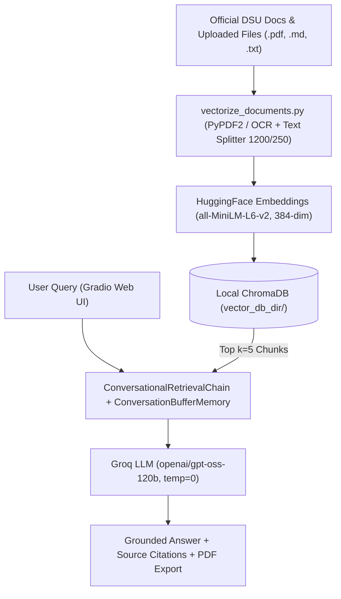

# Project Report: Campus Care — Dayananda Sagar University (DSU) AI Student Support Assistant

**Repository:** `College_RAG_Chatbot`  
**System Name:** Campus Care — Dayananda Sagar University (DSU) AI Student Support Assistant  
**Architecture:** Retrieval-Augmented Generation (RAG) with Local Vector Search & Free-Tier LLM Inference  

---

## 1. Abstract

**Campus Care — Dayananda Sagar University (DSU) AI Student Support Assistant** is an end-to-end Retrieval-Augmented Generation (RAG) conversational platform designed to provide accurate, structured, and source-grounded answers to students, prospective applicants, and parents inquiring about Dayananda Sagar University (DSU). Unlike generic Large Language Model (LLM) chatbots that rely solely on static pre-training data and frequently hallucinate institution-specific facts, Campus Care retrieves verified context from curated university documents (`.pdf`, `.md`, and `.txt`) stored locally in **ChromaDB** using **HuggingFace (`sentence-transformers/all-MiniLM-L6-v2`)** embeddings.

At query time, the system retrieves the top-5 ($k=5$) most semantically relevant document chunks, combines them with multi-turn conversational history via LangChain's `ConversationBufferMemory` and `ConversationalRetrievalChain`, and generates clear, formatted responses using **Groq (`openai/gpt-oss-120b`)**. Every response includes a **Sources** citation footer referencing the exact source file and official DSU URL when available. The platform provides a modern **Gradio** web interface with live document upload and hot-reloading, clickable quick starter prompts, and PDF transcript export, running entirely on a 100% free-tier and local stack.

---

## 2. Introduction & Problem Statement

### 2.1 Background
University students and prospective applicants frequently need quick, reliable answers spanning multiple administrative and academic domains: campus locations, school-wise degree programs, entrance exams (such as DSAT, KCET, COMEDK, JEE Main, CAT, and NEET), eligibility criteria, fee structures, scholarships, hostel facilities, placement statistics, and medical/research infrastructure.

### 2.2 Problem Statement
Information on university portals is typically spread across numerous web pages, PDF handbooks, and department notices. Manually searching through these documents is time-consuming, while standard general-purpose AI chatbots lack access to verified, up-to-date university records and risk fabricating fees, dates, or contact details.

### 2.3 Solution Overview
**Campus Care** solves this by grounding every answer in a local, expandable DSU knowledge base:
- **Zero-Hallucination Grounding:** System and negative prompts strictly restrict responses to retrieved DSU documents and direct users to `admissions@dsu.edu.in` or `080 46461800` when a detail is absent.
- **Transparent Citations:** Every answer displays the exact source documents used.
- **Live Knowledge-Base Expansion:** New PDFs, Markdown, or text files can be uploaded directly through the Gradio UI and indexed immediately without restarting the server.

---

## 3. Objectives

1. **Autonomously Build a Verified DSU Knowledge Base:** Consolidate official DSU campus, academic, admissions, placement, and student-life data into structured Markdown and PDF documents in `data/`.
2. **Optimize RAG Retrieval & Chunking:** Tune text splitting (`chunk_size=1200`, `chunk_overlap=250`) and top-$k$ retrieval ($k=5$) to preserve complete context across multi-section university documents.
3. **Support Live Document Ingestion:** Provide a reusable `ingest_files()` pipeline with `PyPDF2` text extraction and `pytesseract` OCR fallback that appends new vectors to `vector_db_dir/` without wiping existing embeddings.
4. **Deliver a Modern, Accessible Gradio UI:**
   - **Gradio UI** (`gradio_app.py`) branded in DSU Deep Royal Blue (`#0B3D91`) and Warm Gold (`#F59E0B`) on `http://localhost:7860`.
5. **Operate on a 100% Free-Tier / Local Stack:** Eliminate paid-only APIs by combining Groq's free tier with local HuggingFace embeddings and local ChromaDB persistence.

---

## 4. System Architecture



### 4.1 Core Pipeline Components
1. **Document Ingestion Layer (`vectorize_documents.py`):**
   - Loads `.pdf`, `.txt`, and `.md` files from `data/` (excluding `information.md`).
   - Extracts `Source URL:` headers from Markdown files into `Document.metadata["source_url"]`.
   - Uses `PyPDF2.PdfReader` for PDFs with an optional `pytesseract` + `pdf2image` OCR fallback if extracted text is empty.
   - Splits documents via `RecursiveCharacterTextSplitter(chunk_size=1200, chunk_overlap=250)`.
   - Appends vectors to `vector_db_dir/` via `ingest_files()` or performs a clean rebuild via `rebuild_vector_store()`.
2. **Retrieval & Conversational Chain:**
   - `Chroma` vector store queried via `vectorstore.as_retriever(search_kwargs={"k": 5})`.
   - `ConversationBufferMemory` (`memory_key="chat_history"`, `output_key="answer"`, `return_messages=True`) maintains multi-turn context.
   - `ConversationalRetrievalChain.from_llm(..., return_source_documents=True)` combines retrieved context, chat history, and DSU system/negative prompts.
3. **LLM Inference:**
   - `ChatGroq(model="openai/gpt-oss-120b", temperature=0)` reads `GROQ_API_KEY` from `.env` (via `python-dotenv`) with `config.json` fallback.

---

## 5. Knowledge Base & Data Sources

The `data/` directory contains official DSU knowledge-base files and handbooks:

| File | Coverage |
|---|---|
| `data/dsu_campuses_and_helpline.md` | Harohalli Main Campus, Kudlu Gate City Innovation Campus, helplines (`080 46461800`, `080 49092800`), `admissions@dsu.edu.in` |
| `data/dsu_schools_and_programs.md` | Schools of Engineering, Commerce & Management, Computer Applications, Basic & Applied Sciences, Law, Health Sciences, Design, Online Degrees, Ph.D. |
| `data/dsu_admissions_dsat_fees_scholarships.md` | DSAT, KCET/COMEDK/JEE/CAT/NEET, eligibility criteria, approximate fee ranges, and merit/need scholarships |
| `data/dsu_placements_and_career_services.md` | Highest & average packages, CIL training, 500+ recruiters, and Placement Cell contacts |
| `data/dsu_campus_life_hostels_medical_innovation.md` | Hostels, libraries, campus transport, CDSIMER Medical Hospital, and AIC-DSU / industry Innovation Labs |
| `data/BTechHandBook.pdf` | Official B.Tech handbook PDF |

Additionally, `fetch_dsu_docs.py` provides an automated `requests` + `BeautifulSoup4` scraper for `dsu.edu.in` and `admissions.dsu.edu.in` with graceful error handling for WAF-protected or unreachable URLs.

---

## 6. User Interface (`gradio_app.py`)

### 6.1 Gradio Web UI (`gradio_app.py`)
- **URL:** `http://localhost:7860` (`server_name="localhost"`, `server_port=7860`, `inbrowser=True`)
- **Design & Theme:** Custom `gr.themes.Soft` + CSS featuring DSU Deep Royal Blue (`#0B3D91`), Warm Gold (`#F59E0B`), and soft slate cards (`#F8FAFC`).
- **Features:**
  - Branded header banner displaying a live badge count of indexed DSU documents.
  - **Left Sidebar:** DSU Quick Contact & Campuses card, **Knowledge Base & Upload** panel (`gr.File` supporting multiple `.pdf`, `.txt`, `.md` files + `Upload & Index` button that hot-reloads the retriever without restarting), **Indexed Documents** accordion, **Export PDF** (`FPDF`), and **Clear Chat**.
  - **Main Chat Workspace:** `gr.Chatbot` with copy/copy-all buttons, markdown formatting, source citation footers, and 4 clickable **Quick Starter Prompts**.

---

## 7. Technology Stack

| Component | Technology / Package | Purpose |
|---|---|---|
| **Language** | Python `3.13.12` | Core runtime |
| **LLM Provider** | Groq (`langchain-groq`, `openai/gpt-oss-120b`) | Free-tier fast LLM inference |
| **Embeddings** | `langchain-huggingface`, `sentence-transformers` (`all-MiniLM-L6-v2`) | Local 384-dim embeddings |
| **Vector Store** | `langchain-chroma`, `chromadb` | Local persistent vector database |
| **Orchestration** | `langchain`, `langchain-classic`, `langchain-core`, `langchain-text-splitters` | RAG chain, prompts, memory, and chunking |
| **Web UI** | `gradio` (`6.32.0`) | Interactive chat interface, live upload & PDF export |
| **Document / PDF** | `PyPDF2`, `pytesseract`, `fpdf`, `beautifulsoup4`, `requests` | Extraction, OCR, scraping, PDF export |
| **Configuration** | `python-dotenv`, `.env`, `config.json` | Secure API key loading |

---

## 8. Repository Structure

```text
College_RAG_Chatbot/
├── data/                                        # DSU Markdown docs & PDF handbooks
│   ├── dsu_campuses_and_helpline.md
│   ├── dsu_schools_and_programs.md
│   ├── dsu_admissions_dsat_fees_scholarships.md
│   ├── dsu_placements_and_career_services.md
│   ├── dsu_campus_life_hostels_medical_innovation.md
│   ├── BTechHandBook.pdf
│   └── information.md
├── report/
│   └── Campus_Care_DSU_Project_Report.md        # Detailed project report
├── vector_db_dir/                               # Persistent ChromaDB storage
├── images/                                      # Project screenshots & assets
├── gradio_app.py                                # Gradio Web UI (port 7860)
├── vectorize_documents.py                       # Chunking, embedding & live ingestion
├── fetch_dsu_docs.py                            # Official DSU web/PDF scraper
├── requirements.txt                             # Python 3.13-compatible dependencies
├── .env.example                                 # Environment variable template
├── .gitignore                                   # Excludes .env, config.json, .venv/
└── README.md                                    # Repository documentation
```

---

## 9. Setup & Execution Guide

1. **Activate Virtual Environment & Install Dependencies (Windows PowerShell):**
   ```powershell
   cd d:\College_RAG_Chatbot
   .\.venv\Scripts\Activate.ps1
   pip install -r requirements.txt
   ```
2. **Configure Environment Variable:**
   Copy `.env.example` to `.env` and set your free Groq API key:
   ```env
   GROQ_API_KEY=your_groq_api_key_here
   ```
3. **Rebuild the Vector Database (whenever `data/` changes):**
   ```powershell
   .\.venv\Scripts\python.exe vectorize_documents.py
   ```
4. **Launch the Application:**
   ```powershell
   .\.venv\Scripts\python.exe gradio_app.py
   ```
   Open **`http://localhost:7860`** in your browser.

---

## 10. Engineering Challenges Solved

1. **LangChain v0.2 → v1.x Migration:** Migrated broken legacy imports (`langchain.memory`, `langchain.chains`, `langchain.prompts`, `langchain.text_splitter`, `langchain.schema`) to `langchain_classic`, `langchain_core`, and `langchain_text_splitters` for Python 3.13 compatibility.
2. **Windows Virtual Memory Limit (`os error 1455`):** Replaced the heavy default `all-mpnet-base-v2` (~420 MB) model with `all-MiniLM-L6-v2` (~90 MB) and added resource caching so the app loads reliably without exhausting the Windows paging file.
3. **Streamlit / FastAPI Entry-Point Collision:** Separated `app = FastAPI()` out of `main.py` into `api.py` after observing Streamlit `1.57.0`'s internal Uvicorn server resolving `main:app` instead of serving the Streamlit UI.
4. **Groq Model Availability:** Updated the LLM from `llama-3.3-70b-versatile` (which returned `404 model_not_found`) to `openai/gpt-oss-120b`.
5. **WAF-Protected Web Scraping:** Handled `HTTP 403` responses from `dsu.edu.in` gracefully in `fetch_dsu_docs.py` and populated `data/` with verified DSU Markdown documents preserving official source URLs.

---

## 11. Conclusion & Future Scope

**Campus Care — Dayananda Sagar University (DSU) AI Student Support Assistant** delivers a complete, zero-cost, production-structured RAG solution for university student support. It combines verified institutional knowledge, live document ingestion, multi-turn memory, source citations, and PDF export in a modern Gradio web interface.

**Future Enhancements:**
- Automated scheduled re-indexing when new DSU circulars or academic calendars are published.
- Hybrid search combining BM25 keyword matching with ChromaDB semantic retrieval.
- Role-based authentication for administrators managing the `Knowledge Base & Upload` panel.
- Persistent database-backed conversation history per student session.
